# Práctica 4: Gestión de archivos multiplataforma (Android e iOS)

| | |
|---|---|
| **Alumno** | Rangel Mata José Luis |
| **Boleta** | 2023630577 |
| **Grupo** | 7CV4 |
| **Asignatura** | Desarrollo de aplicaciones móviles nativas |
| **Profesor** | Gabriel Hurtado Avilés |
| **Escuela** | Instituto Politécnico Nacional, Escuela Superior de Cómputo (ISC, plan 2020) |

## Cómo ejecutar (resumen)

**Android** (solo requiere Android Studio; JDK y Gradle vienen incluidos):

1. Clonar el repositorio.
2. En Android Studio: *File > Open* y elegir `gestor-archivos-kmp/` o `juego-partidas-kmp/`.
3. Esperar la sincronización de Gradle (descarga dependencias la primera vez; requiere Internet solo para compilar).
4. Elegir un emulador o dispositivo (API 24 o superior) y pulsar **Run**.
   - Gestor: configuración de ejecución `androidApp`.
   - Juego: configuración de ejecución `composeApp`.

**iOS** (requiere macOS con Xcode; sin CocoaPods):

1. Abrir `iosApp/iosApp.xcodeproj` dentro de cada proyecto.
2. Elegir un simulador iOS 15 o superior (Mac con Apple Silicon) y pulsar **Run**.
3. La primera compilación descarga el compilador Kotlin/Native (unos 5 min).

Cada proyecto incluye su propio `README.md` con más detalle.

## Introducción

Se desarrollaron dos aplicaciones móviles que funcionan 100 % sin conexión, para Android (API 24+) e iOS (15+), con **Kotlin Multiplatform y Compose Multiplatform** (UI compartida):

| Parte | Proyecto | Descripción |
|---|---|---|
| 1 | [`gestor-archivos-kmp`](gestor-archivos-kmp) | Gestor de archivos que opera únicamente sobre el espacio propio de la app y las carpetas que el usuario autoriza con el selector del sistema. |
| 2 | [`juego-partidas-kmp`](juego-partidas-kmp) | **Circuito Guinda**, juego original de puzzle de rutas con partidas que se guardan, cargan, visualizan y exportan en TXT, XML y JSON. |

Se eligió KMP (y no Flutter) para que el proyecto abra y corra en Android Studio sin instalar SDK adicionales. Ambas apps tienen los temas **Guinda** (IPN) y **Azul** (ESCOM), con adaptación automática al modo claro/oscuro del sistema.

## Desarrollo

### Parte 1: Gestor de archivos

- Exploración del espacio privado de la app y de carpetas elegidas con el selector del sistema, con *breadcrumbs*.
- Visores: texto y Markdown; JSON y XML con formato y resaltado de sintaxis propio; imágenes con zoom y rotación.
- Formatos no soportados: diálogo para abrir, compartir o exportar con las funciones del sistema.
- Metadatos: nombre, tamaño, fecha, tipo MIME/UTType; muestra «No disponible» cuando falta un dato.
- Recientes y favoritos persistentes, caché de miniaturas.
- Copiar, mover, renombrar y eliminar con confirmación en acciones destructivas y validación previa.
- Manejo de errores (ruta no disponible, permiso revocado, archivo inexistente, lectura fallida, sin espacio) sin bloquear la app.
- Datos de ejemplo sembrados en el primer arranque (txt, md, json, xml, png, bin).

### Parte 2: Circuito Guinda

- Puzzle de rutas con losetas giratorias: se conecta todo el tablero a la fuente de energía.
- Modos **Clásico** y **Reto** (límite de movimientos), puntuación, progreso, deshacer y continuar partida con autoguardado.
- Efectos visuales (animaciones y partículas en Canvas), sonidos WAV sintetizados en memoria y vibración.
- Guardado en **TXT, XML y JSON** a elección del usuario; carga desde cualquiera de los tres.
- Se guarda estado, puntuación, tiempo, configuración e historial de movimientos.
- Lista de partidas con metadatos, etiquetas y filtro; exportar, compartir, importar y visor del archivo crudo.
- Validación de archivos vacíos, incompletos o corruptos con error legible, sin afectar otras partidas.

## Implementación

- **Arquitectura compartida:** casi toda la lógica y la UI están en `commonMain` (Kotlin + Compose Multiplatform). Las operaciones de plataforma se inyectan mediante interfaces (`FileStore`, `PlatformServices`) y `expect/actual` para fecha, imágenes y miniaturas.
- **Android:** Storage Access Framework (`ACTION_OPEN_DOCUMENT_TREE`, `ACTION_CREATE_DOCUMENT`, permisos URI persistentes), `FileProvider` y *Intent chooser* para compartir. Sin permisos de almacenamiento global (Scoped Storage).
- **iOS:** sandbox de la app, `UIDocumentPickerViewController` con URLs *security-scoped* y `UIActivityViewController` para compartir.
- **Serialización (juego):** TXT (clave=valor), XML y JSON (kotlinx-serialization) con versión de esquema y excepciones propias para validar.
- **Persistencia:** archivos en el directorio privado de la app (partidas en `saves/`, preferencias en JSON).

Detalle completo en el README de cada proyecto.

### Versiones

| | Gestor | Juego |
|---|---|---|
| Kotlin | 2.4.21 | 2.4.21 |
| Compose Multiplatform | 1.12.2 | 1.11.1 |
| AGP / Gradle | 9.5.1 / 9.6.1 | 8.13.2 / 9.3.1 |
| compileSdk / minSdk | 37 / 24 | 36 / 24 |
| iOS mínimo | 15.0 | 15.0 |

Entorno de desarrollo: macOS, Android Studio 2026.2, Xcode 27.2.

## Capturas de pantalla

### Parte 1: Gestor de archivos, Android (emulador)

| Captura | Descripción |
|---|---|
| 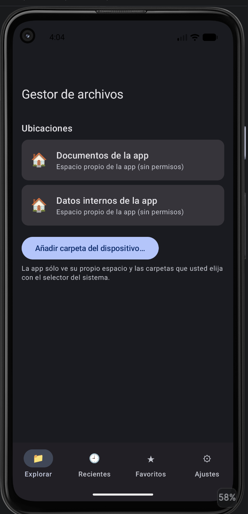 | Inicio, tema **Azul**, modo oscuro |
| 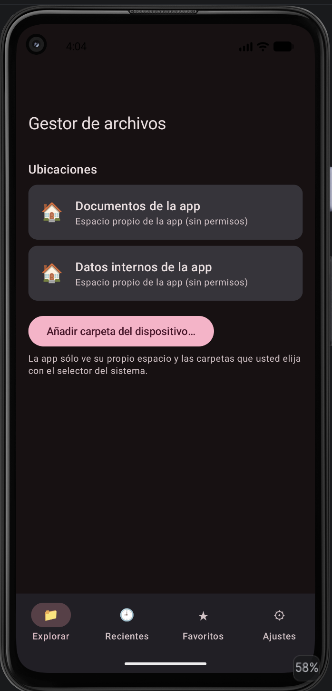 | Inicio, tema **Guinda**, modo oscuro |
| 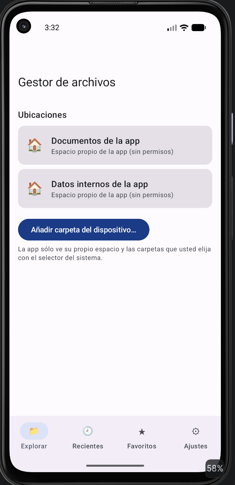 | Inicio, tema **Azul**, modo claro |
| 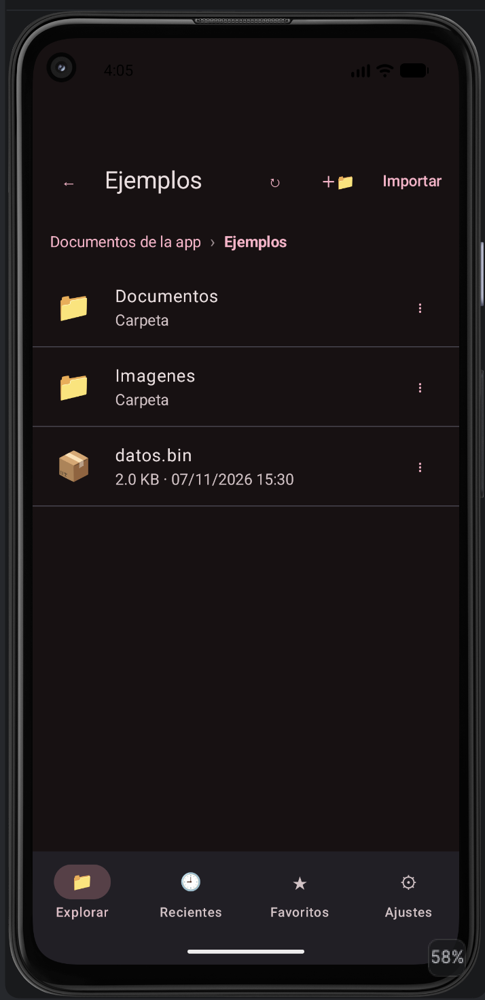 | Navegación con *breadcrumbs* en `Ejemplos` |
| 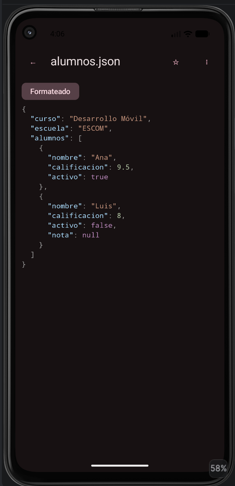 | Visor JSON con resaltado y formato |
| 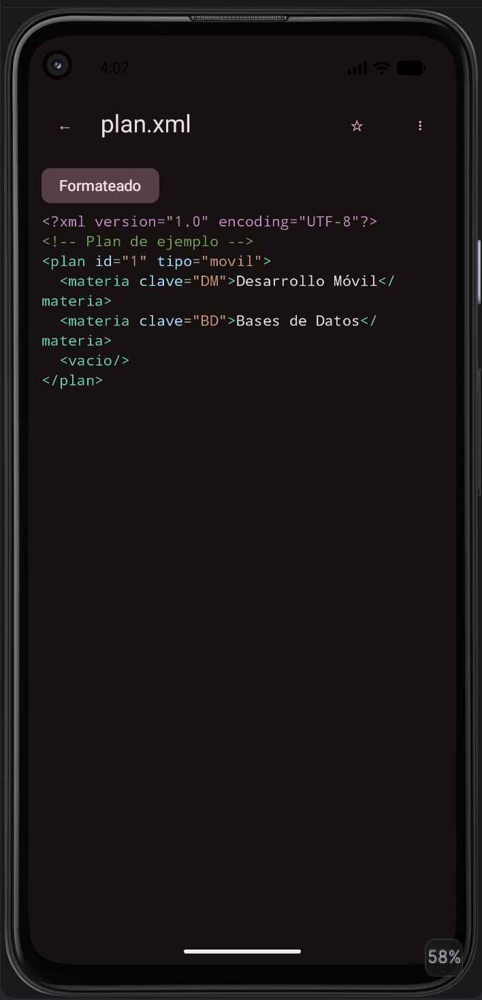 | Visor XML con resaltado y formato |
| 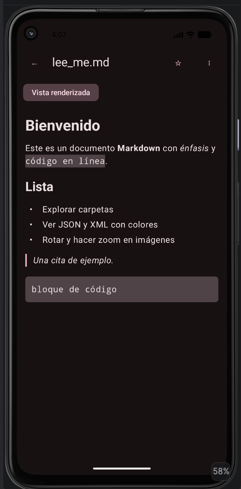 | Markdown renderizado |
| 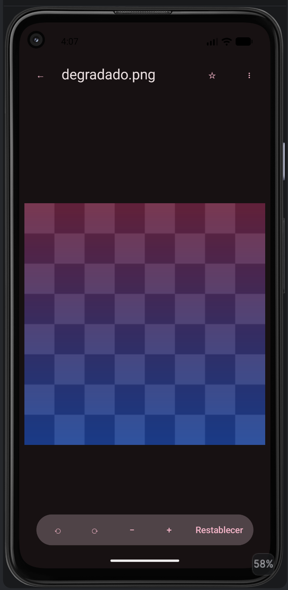 | Imagen con controles de rotación y zoom |
| 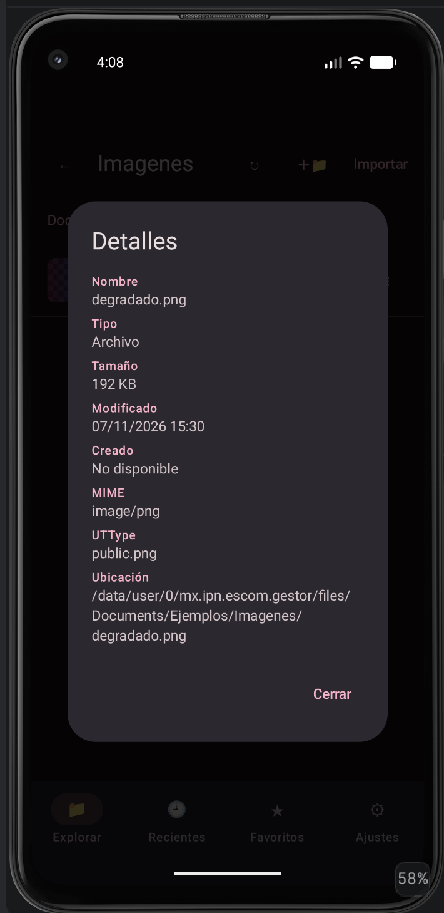 | Metadatos (la fecha de creación aparece como «No disponible») |
| 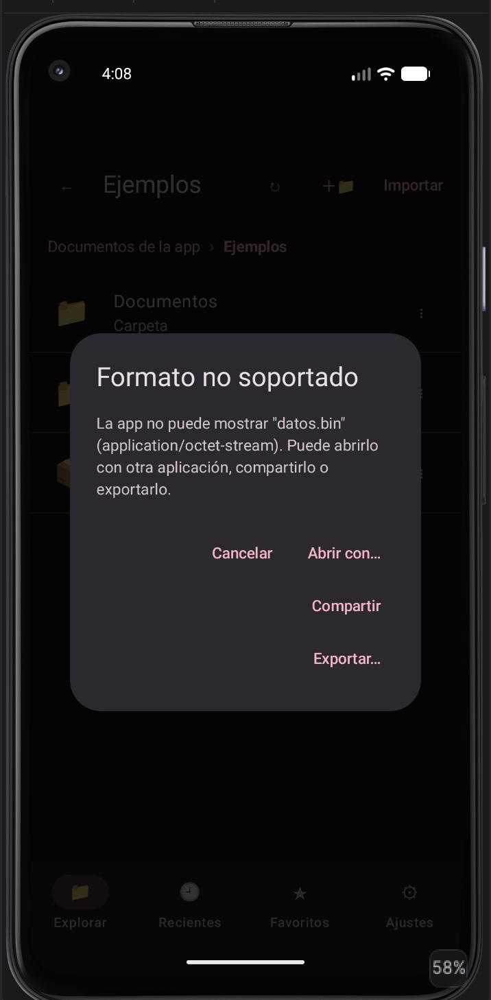 | Diálogo de formato no soportado (abrir, compartir, exportar) |
| 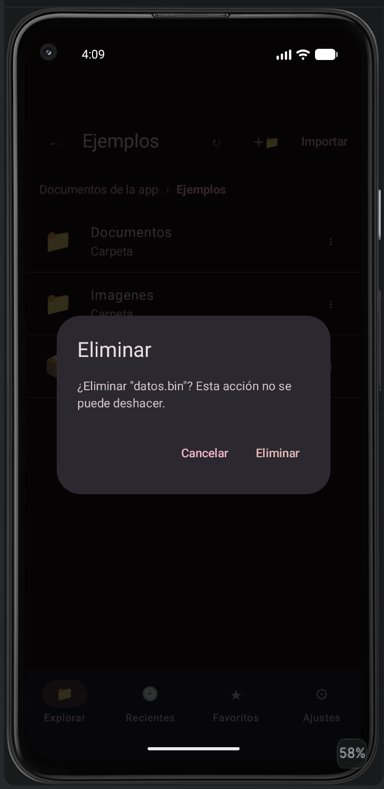 | Confirmación antes de eliminar |
| 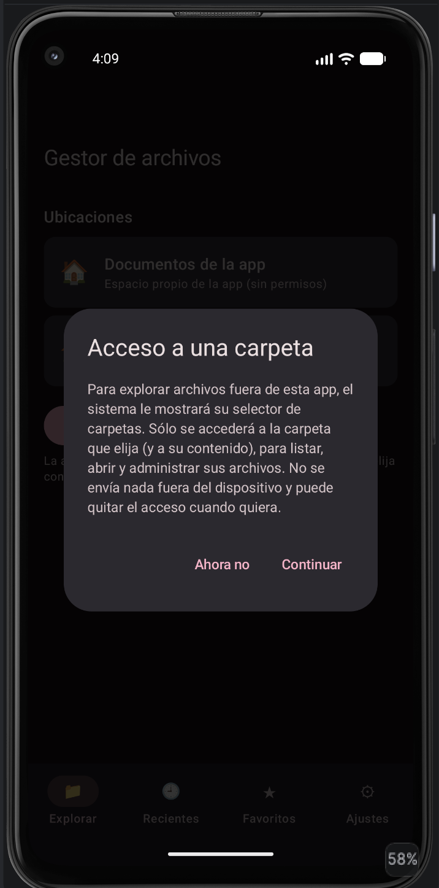 | Explicación de la finalidad antes de abrir el selector del sistema |

*Pendientes:* gestor en iOS, tema Guinda en modo claro y juego en Android e iOS.

## Pruebas realizadas

Resultados reales hasta ahora (compilación y pruebas automatizadas):

| Prueba | Sistema | Resultado |
|---|---|---|
| Compilación `assembleDebug` (gestor: `:androidApp`, juego: `:composeApp`) | Android | Correcta |
| Compilación iOS (`linkDebugFrameworkIosSimulatorArm64` y `xcodebuild` para simulador) | iOS | Correcta, ambos proyectos |
| Pruebas unitarias del gestor (21): resaltado, formato, Markdown, preferencias, operaciones de archivo, datos de ejemplo | JVM/Android host | Todas pasan |
| Pruebas unitarias del juego (22): ida y vuelta TXT/XML/JSON, archivos vacíos, truncados y corruptos, lógica del juego, WAV | JVM/Android host | Todas pasan |

**Aún sin verificar en ejecución real** (emulador, simulador o dispositivo): selectores de archivos (SAF y document picker), compartir/exportar, audio, vibración, gestos de zoom, persistencia de permisos y comportamiento sin conexión. La matriz de pruebas manual (SO, versión, dispositivo, pasos, esperado, obtenido, evidencia) se completará con las ejecuciones reales.

## Conclusiones

KMP permitió compartir la lógica y la interfaz, dejando en cada plataforma solo el acceso a archivos, que es donde Android (Scoped Storage, SAF) e iOS (sandbox, document picker) difieren más. La principal lección fue diseñar el acceso a archivos como interfaces para poder probar la lógica en pruebas unitarias sin depender del sistema operativo.

## Bibliografía

- Android Developers. (s. f.). *Access documents and other files from shared storage* (Storage Access Framework). Google. https://developer.android.com/training/data-storage/shared/documents-files
- Android Developers. (s. f.). *Data and file storage overview*. Google. https://developer.android.com/training/data-storage
- Apple Inc. (s. f.). *UIDocumentPickerViewController*. Apple Developer Documentation. https://developer.apple.com/documentation/uikit/uidocumentpickerviewcontroller
- JetBrains. (s. f.). *Kotlin Multiplatform documentation*. https://kotlinlang.org/docs/multiplatform.html
- JetBrains. (s. f.). *Compose Multiplatform*. https://www.jetbrains.com/compose-multiplatform/
- Kotlin Foundation. (s. f.). *kotlinx.serialization*. https://github.com/Kotlin/kotlinx.serialization
